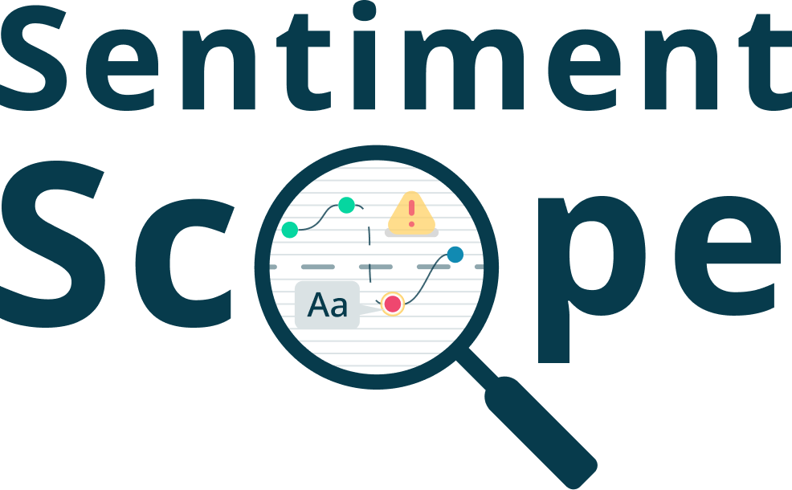

<div align="center">

# NewsAnalysis

### From news articles to an auditable map of public positions.

Extract statements, resolve people and topics, measure attitudes, and detect
meaningful position changes — without losing the source evidence behind them.

<p>
  
  
  
  
  
</p>

</div>

<div align="center">



</div>

## Why NewsAnalysis?

NewsAnalysis turns unstructured reporting into structured, historically
traceable knowledge:

```text
Article
  └─ Citation
      ├─ Person
      ├─ Topic
      └─ Attitude
             └─ Historical comparison
                    ├─ Consistent
                    ├─ Position change
                    └─ Contradiction
```

The system treats an LLM as an analytical component — never as the source of
truth. Every important conclusion can be followed back to the original quote,
article, and evidence pair that produced it.

## Highlights

- **Evidence-first analysis** — exact quotes are preserved alongside summaries
  and derived classifications.
- **Canonical entities** — vector search retrieves candidate people and topics;
  relational IDs and constraints remain authoritative.
- **Semantic stance model** — direction, endorsement, commitment, and
  conditionality produce a bounded stance value.
- **Careful historical reasoning** — a changed position is not automatically a
  contradiction.
- **Durable orchestration** — jobs, stages, retries, cancellation, idempotency,
  recovery, and telemetry live outside the analytical database.
- **Operational dashboard** — inspect jobs, stages, LLM latency, tokens, logs,
  services, experiments, and analytical records.
- **Evidence visualisation** — explore speakers, stance timelines, similarity,
  source quotes, and inconsistency links.
- **Benchmarking** — compare models and configurations without modifying
  production analytical state.

## Architecture

```text
                         ┌──────────────────────┐
                         │ Management dashboard │
                         └──────────┬───────────┘
                                    │
┌───────────────┐      ┌────────────▼───────────┐      ┌────────────────┐
│ Article input │ ───► │ Management service     │ ───► │ Analysis layer │
└───────────────┘      │ jobs · stages · retry  │      │ LLM pipeline   │
                       └────────────┬───────────┘      └───────┬────────┘
                                    │                          │
                                    ▼                          ▼
                       ┌──────────────────────┐      ┌────────────────┐
                       │ Data-storage API     │      │ LLM provider   │
                       │ transactions/search  │      │ OpenAI-compatible│
                       └────────────┬─────────┘      └────────────────┘
                                    ▼
                       ┌──────────────────────┐
                       │ PostgreSQL + pgvector│
                       └──────────────────────┘

 Benchmark service ──► isolated model evaluation
 Visualisation service ──► read-only evidence exploration
```

| Service | Responsibility |
|---|---|
| `management-service` | Durable jobs, tasks, stages, retries, cancellation, telemetry |
| `analysis-layer` | Extraction, refinement, entity/topic resolution, stance, comparison |
| `data-storage` | PostgreSQL API, transactions, embeddings, vector search |
| `benchmark-service` | Isolated quality, latency, and token experiments |
| `management-dashboard` | Operational control and investigation |
| `visualisation-service` | Read-only analytical views and evidence timelines |

## Quick start

### Requirements

- Docker Desktop with Docker Compose
- An OpenAI-compatible LLM endpoint, such as LM Studio
- An embedding endpoint compatible with the configured storage settings

### Run the stack

```powershell
Copy-Item .env.example .env
Copy-Item analysis-layer\app\.env.example analysis-layer\app\.env
Copy-Item data-storage\app\.env.example data-storage\app\.env
Copy-Item management-service\.env.example management-service\.env

docker compose up --build
```

Then open:

| Interface | URL |
|---|---|
| Management dashboard | [localhost:3001](http://localhost:3001) |
| Evidence visualisation | [localhost:3002](http://localhost:3002) |
| Management API docs | [localhost:9000/docs](http://localhost:9000/docs) |
| Analysis API docs | [localhost:7000/docs](http://localhost:7000/docs) |
| Storage API docs | [localhost:8000/docs](http://localhost:8000/docs) |
| PostgreSQL | `localhost:5432` |

The dashboard and visualisation UI can start independently of production data:
the visualisation service begins in mock-data mode and can be switched to live
data from the interface.

> **Security:** the example configuration is for local development. Replace
> database passwords, API keys, and provider URLs before exposing the stack.

### Provider modes

The provider mode is selected independently in each service's `.env` file.
Use `local` for the previous OpenAI-compatible local server, or `google` for
Google's hosted API:

```text
# Local mode
LLM_PROVIDER=local
LLM_URL=http://host.docker.internal:1234/v1
LLM_MODEL=google/gemma-4-e4b
LLM_API_KEY=fake_api_key
LLM_REASONING_PARAMETER=chat_template_kwargs.enable_thinking

EMBEDDING_PROVIDER=local_model
EMBEDDING_URL=http://host.docker.internal:1234/v1
EMBEDDING_MODEL=/app/models/embeddinggemma-300M-Q8_0.gguf
EMBEDDING_API_KEY=local_embedding_provider
EMBEDDING_DIMENSION=768

# Google mode
LLM_PROVIDER=google
LLM_URL=https://generativelanguage.googleapis.com/v1beta/openai/
LLM_API_KEY=<Google AI Studio API key>
LLM_MODEL=<a chat model available to your API key>
LLM_REASONING_PARAMETER=

EMBEDDING_PROVIDER=google
EMBEDDING_URL=https://generativelanguage.googleapis.com/v1beta
EMBEDDING_API_KEY=<Google AI Studio API key>
EMBEDDING_MODEL=gemini-embedding-001
EMBEDDING_BATCH_SIZE=80
EMBEDDING_OUTPUT_DIMENSION=768
EMBEDDING_DIMENSION=768
```

Google chat model names are normalized by removing an optional `models/`
prefix. Google embeddings use the native `batchEmbedContents` API, in batches
of at most 100 requests. The `local_model` mode loads the ignored GGUF file
from `data-storage/models/` with llama.cpp and sends the complete local bulk
input without the Google batch limit. Set `EMBEDDING_MODEL` to the GGUF path
used inside the container. The GGUF file must be copied into
`data-storage/models/` on each deployment because that directory is excluded
from Git.

## Analysis pipeline

The management service coordinates the workflow; the analysis layer determines
meaning.

1. **Retrieve** the article and validate its availability.
2. **Extract** speakers, exact quotes, context, citation type, and confidence.
3. **Refine** boundaries and attribution while preserving the original quote.
4. **Filter** weak, vague, anonymous, or ineligible evidence according to
   configured rules.
5. **Resolve people** against canonical profiles using vector candidate search
   and deterministic persistence rules.
6. **Analyse topics and stance** for each person’s article-level citation batch.
7. **Persist attitudes** with relevance, stance, and confidence dimensions.
8. **Retrieve historical candidates** for the same person and canonical topic.
9. **Compare evidence** and persist consistency, position-change, or
   contradiction assessments with both citation references.

Important defaults include `0.35` minimum attribution/extraction confidence,
`0.85` person/topic candidate similarity, `0.75` historical candidate
similarity, and a top five historical comparison bound. All are configurable.

## Data model

The analytical database is intentionally small and explicit:

```text
DimArticle
DimPerson
DimCitation
DimTopic
FctAttitude
FctInconsistency
```

- **Citation** stores the evidence: exact quote, context, source, attribution,
  extraction metadata, and derived summary.
- **Person** and **Topic** are canonical entities with aliases/descriptions and
  optional embeddings for retrieval.
- **Attitude** connects a citation to a topic and records stance, relevance,
  and confidence.
- **Inconsistency** connects two evidence records and records the comparison
  classification, severity, confidence, and explanation.

Vectors help find candidates. UUIDs, foreign keys, constraints, and source
quotes remain authoritative.

## Management and observability

The management service stores operational state separately in SQLite. It
provides:

- idempotent article jobs and multi-article tasks;
- stage-level progress and pipeline graphs;
- retry and cooperative cancellation;
- restart handling and bounded execution deadlines;
- structured logs and Server-Sent Events;
- LLM request latency, token, throughput, and error metrics;
- data browsing, semantic search, editing, and evidence links;
- experiments and benchmark run management.

This separation keeps orchestration concerns out of the analytical database
and lets operators inspect *what happened* without changing *what the system
concluded*.

## Development

Useful focused commands:

```powershell
# Run a service locally
cd analysis-layer
python -m uvicorn app.main:app --reload --port 7000

# Run service tests
pytest

# Build only a changed Compose service
docker compose build analysis-layer
docker compose up analysis-layer
```

Each service has its own dependencies, configuration, tests, and API boundary.
Prefer short service-level feedback loops before rebuilding the full stack.

## Documentation

- [Complete system report](SYSTEM_REPORT.md) — architecture, pipeline logic,
  conditions, database fields, queries, telemetry, dashboard, and visualisation
- [Analysis pipeline notes](analysis-layer/app/ANALYSIS_PIPELINE.md) —
  implementation-level stages and thresholds
- [Management service](management-service/README.md) — jobs, telemetry,
  dashboard, experiments, and recovery
- [Visualisation service](visualisation-service/README.md) — live/mock mode,
  semantic filtering, and timeline behavior
- [Benchmark service](benchmark-service/README.md) — isolated model evaluation

## Design principles

> Preserve evidence first. Derive structured knowledge second. Interpret only
> from traceable evidence.

- A different stance is not automatically a contradiction.
- A similar name is not automatically the same person.
- A high embedding similarity is not an identity decision.
- An LLM confidence value is not factual truth.
- Uncertainty is preserved instead of silently converted into certainty.

