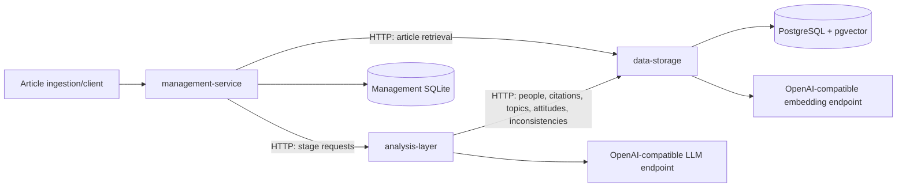
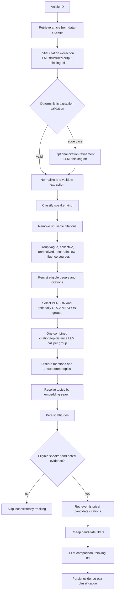
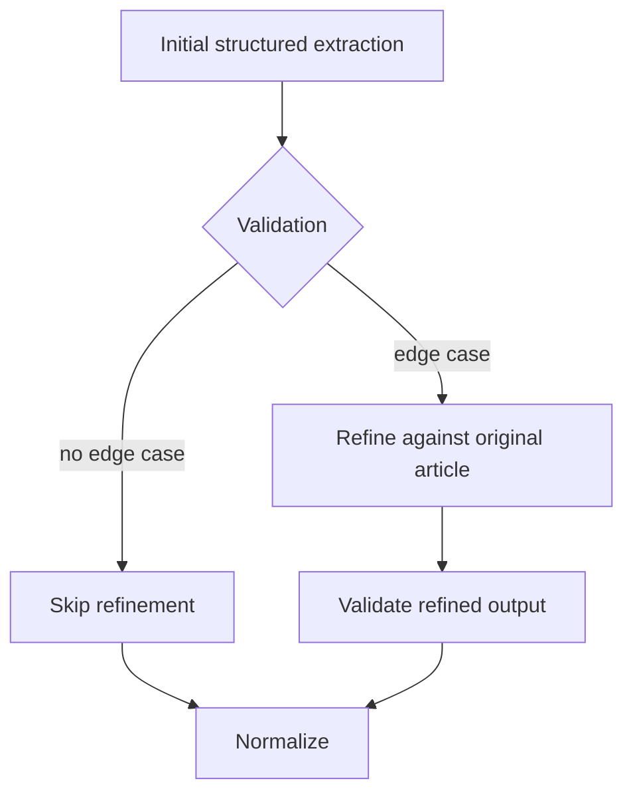
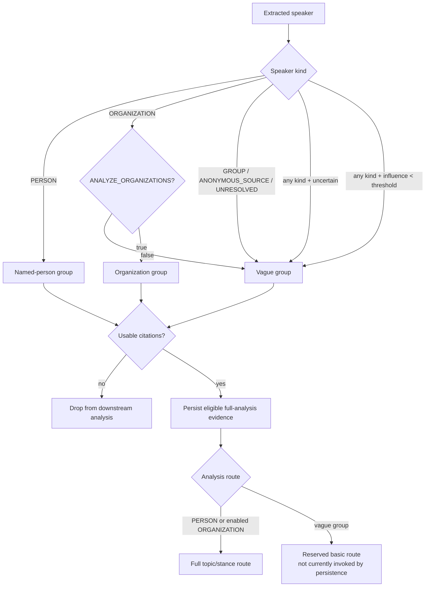
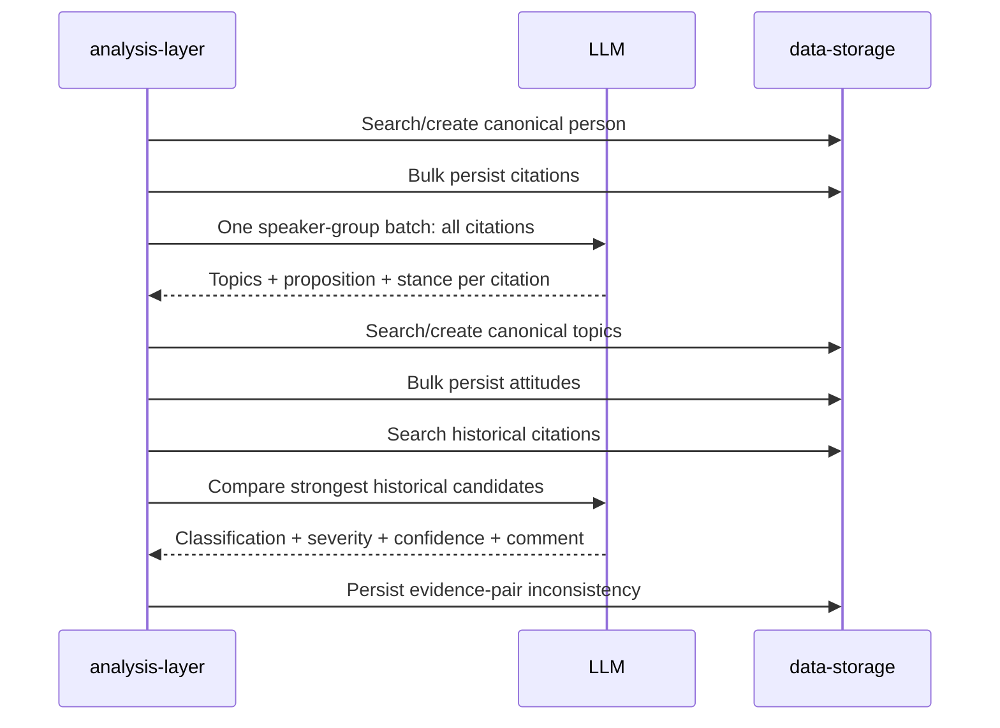
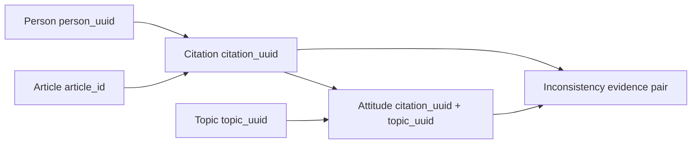
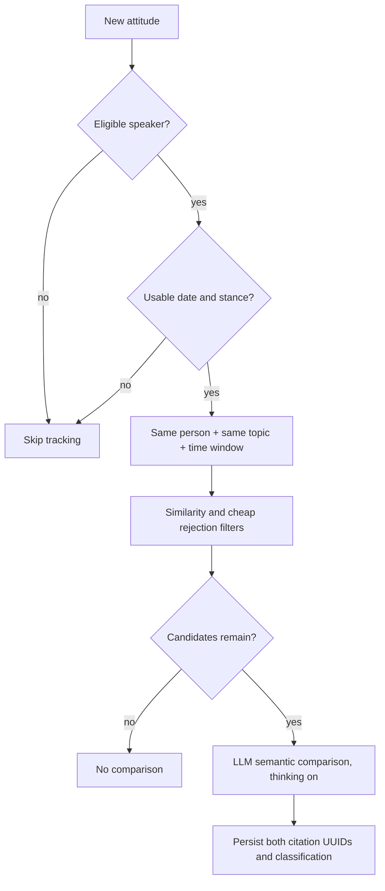
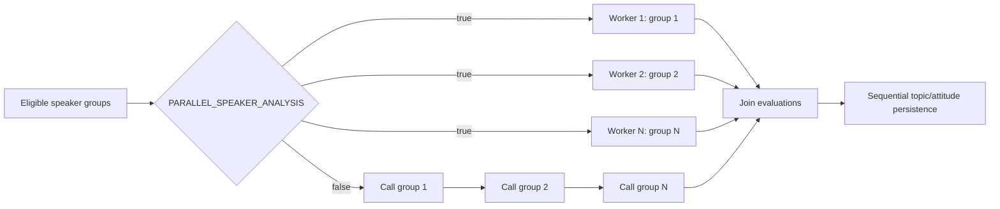

# NewsAnalysis Analysis Pipeline

## 1. Purpose and scope

This document is the complete operational and semantic breakdown of the current
NewsAnalysis pipeline. It describes the implemented non-legacy services:

```text
data-storage -> management-service -> analysis-layer -> data-storage
                         |
                         +-> management SQLite (jobs, stages, telemetry)
```

The pipeline converts an article into traceable analytical records:

```text
Article
  -> extracted speaker groups
  -> citations
  -> canonical people
  -> canonical topics
  -> attitudes
  -> historical comparisons
  -> inconsistencies
```

The authoritative implementation is in:

- [`analysis-layer/app/models.py`](analysis-layer/app/models.py)
- [`analysis-layer/app/prompts.py`](analysis-layer/app/prompts.py)
- [`analysis-layer/app/LLM.py`](analysis-layer/app/LLM.py)
- [`analysis-layer/app/analysis.py`](analysis-layer/app/analysis.py)
- [`management-service/app/orchestration.py`](management-service/app/orchestration.py)
- [`data-storage/app/schemas.py`](data-storage/app/schemas.py)

Legacy code is intentionally excluded.

## 2. Architectural boundaries



### Responsibility matrix

| Component | Owns | Must not own |
|---|---|---|
| `management-service` | Job lifecycle, stage ordering, cancellation, retries, idempotency, task aggregation, telemetry | Analytical interpretation or direct PostgreSQL access |
| `analysis-layer` | Extraction prompts, refinement, speaker routing, person/topic resolution, topic/stance analysis, historical comparison | Application database ownership |
| `data-storage` | PostgreSQL persistence, relational constraints, embeddings, vector search, CRUD/bulk APIs | LLM decisions |
| PostgreSQL/pgvector | Durable analytical records and vectors | Workflow coordination |
| Management SQLite | Jobs, stages, events, experiment metadata, operational metrics | Analytical source-of-truth entities |

Container-to-container URLs use Compose service names:

```text
management-service -> http://analysis-layer:7000
management-service -> http://data-storage:8000
analysis-layer     -> http://data-storage:8000
```

## 3. End-to-end flow



### Current management-service stage order

For a normal per-article job:

1. `article_retrieval`
2. `citation_extraction`
3. `extraction_persistence`
4. `citation_analysis`

`citation_analysis` internally performs:

1. person resolution;
2. citation bulk persistence;
3. one combined topic/stance call per eligible speaker group;
4. topic resolution;
5. attitude bulk persistence;
6. historical candidate retrieval and inconsistency comparison.

For bundled tasks, management coordinates the same logical stages in batches
without moving analytical logic into the coordinator.

## 4. Article input contract

`AnalysisRequest` accepts:

| Field | Type | Constraints/default | Meaning |
|---|---|---|---|
| `article_id` | UUID | Optional at analysis model level | Article identity |
| `article_title` | string | Default `""` | Title supplied to extraction |
| `article_content` | string | Default `""` | Full source text supplied to extraction |
| `published_at` | datetime/null | ISO parsing; nullable | Date used for historical filtering |
| `inconsistency_window_days` | integer | Default `365`, range `1..3650` | Historical comparison window |

A missing publication date does not prevent extraction or attitude persistence,
but it prevents a reliable date-bounded historical comparison.

## 5. Stage 1: citation extraction

### Objective

Extract every attributable statement, opinion, or position while preserving
source evidence. Citations are grouped by speaker for batch analysis.

The structured extraction output contains:

```text
article_title
status
speakers[]
  speaker_name
  speaker_role
  aliases[]
  speaker_kind
  influence_score
  uncertain
  uncertainty_reason
  citations[]
    exact_quote
    context
    citation_type
    summarized_quote
    confidence_level
    extraction_confidence
```

### LLM extraction rules

- Preserve direct wording exactly.
- For paraphrases, use the article wording as `exact_quote` and classify the
  citation accordingly.
- Do not invent speakers, aliases, quotes, or unsupported details.
- A mere mention is not a position.
- Classify every speaker as `PERSON`, `ORGANIZATION`, `GROUP`,
  `ANONYMOUS_SOURCE`, or `UNRESOLVED`.
- `influence_score` measures impact on the article's main story, not credibility.
- Set `uncertain=true` and explain `uncertainty_reason` when attribution/evidence
  is ambiguous.
- Return an empty speaker list when no attributable statements exist.

### Citation types

| Type | Definition | Downstream behavior |
|---|---|---|
| `direct` | Exact words reproduced as the speaker's own speech | Full eligibility if confidence gates pass |
| `partial` | Direct and indirect wording combined | Full eligibility if confidence gates pass |
| `indirect` | Specific attributed statement paraphrased by the article | Full eligibility if confidence gates pass |
| `summary` | General content or main ideas summarized | Eligible if evidence and confidence are sufficient |
| `position` | General attributed belief, support, opposition, or advocacy | Eligible if evidence and confidence are sufficient |
| `mention` | Mere association or mention without an attributable position | Evidence may be retained, but no topic/attitude is generated |

### Reasoning mode

```text
Initial extraction: thinking=off
```

Extraction is a schema-constrained recall task. Expensive reasoning is reserved
for ambiguous person resolution and inconsistency comparison.

## 6. Stage 2: optional citation refinement

Refinement is not unconditional. `_needs_citation_refinement` requests a second
LLM call only when deterministic checks identify an edge case.

### Refinement triggers

- status is not `PROCESSED`, `COMPLETE`, or `COMPLETED`;
- missing speaker name;
- unsupported speaker kind;
- uncertain speaker or uncertainty reason;
- non-numeric, non-finite, or out-of-range influence;
- empty quote;
- malformed confidence;
- unsupported citation type;
- duplicate quote within a speaker;
- same quote attributed to different speakers;
- suspicious quote boundary (`...` at either edge);
- unbalanced quotation marks.

Refinement must:

- audit against the original article;
- add omitted attributable statements;
- remove unsupported items;
- repair attribution, boundaries, type, and context;
- preserve valid items;
- omit insufficient evidence rather than guess;
- keep direct quotes character-for-character apart from surrounding quote marks.



Refinement uses `thinking=off`; the original article remains in the prompt.

## 7. Stage 3: speaker classification and routing

### Speaker kinds

| Kind | Meaning | Persist | Person resolution | Topic/attitude | Inconsistency |
|---|---|---:|---:|---:|---:|
| `PERSON` | Named real-world person | Yes | Yes | Full | Yes, if date/evidence qualify |
| `ORGANIZATION` | Company, government, ministry, agency, etc. | Yes when eligible | Only when `ANALYZE_ORGANIZATIONS=true` | Optional | Only if routed as an analyzed entity |
| `GROUP` | Collective such as public, users, researchers, voters | Extraction result only in current path | No | Not currently routed | No |
| `ANONYMOUS_SOURCE` | Vague source such as experts, industry sources, others | Extraction result only in current path | No | Not currently routed | No |
| `UNRESOLVED` | Cannot reliably classify or identify | Extraction result only in current path | No | Not currently routed | No |

The deterministic classifier uses the model's explicit kind first. If it is
`UNRESOLVED`, it applies name/role heuristics for vague sources,
organizations, collectives, and capitalized multi-word names.

### Eligibility rules

An individual citation is usable only when:

```text
exact_quote/context/summarized_quote contains source text
AND confidence_level >= MIN_ATTRIBUTION_CONFIDENCE
AND extraction_confidence >= MIN_EXTRACTION_CONFIDENCE
```

Empty or low-confidence citations are removed before persistence and analysis.

### Grouping rule

The following are merged into one batch identity:

- anonymous/vague sources;
- collective/group sources;
- unresolved sources;
- uncertain speakers;
- speakers with influence below `LOW_INFLUENCE_THRESHOLD`.

The synthetic group is named **Vague and unresolved sources**. The combined
prompt defines how such a group would be analyzed independently, but the current
`persist_extraction` path filters it out of `analysis_speakers`; consequently
these citations are not currently persisted or sent to the combined analysis
call. They remain present in the extraction result returned by the extraction
stage. They must never be interpreted as one real person's profile.

This implements the low-call strategy: one batch call for all eligible
citations in a speaker group rather than one call per citation.



## 8. Stage 4: extraction persistence

The analysis layer resolves eligible people through:

```http
POST /people/search
  ?limit=1
  &min_similarity=PERSON_MIN_COSINE_SIMILARITY
```

If no match meets the threshold, it creates a person. The authoritative person
identifier is `person_uuid`; embeddings are retrieval aids, not identity proof.

Eligible citations are then sent in one bulk request:

```http
POST /citations/bulk
```

Each persisted citation retains:

```text
origin_article_id
person_uuid (nullable for evidence-only sources)
exact_quote
context
citation_type
summarized_quote
confidence_level
extraction_confidence
```

Storage returns created/retrieved counts through response headers, which are
added to stage statistics.

## 9. Stage 5: combined citation/topic/attitude analysis

For each eligible full-analysis speaker group, the pipeline makes one structured
LLM call using `COMBINED_CITATION_ANALYSIS_PROMPT`.

The call simultaneously:

1. evaluates each citation;
2. identifies supported topics;
3. defines each topic as a reusable proposition;
4. assigns stance from `-10` to `+10`;
5. returns relevancy and stance confidence;
6. writes a short evidence-based stance summary.



### Combined prompt rules

- Analyze all citations for the group in one pass.
- Do not infer stance from a bare mention.
- For `ANONYMOUS_SOURCE` and `UNRESOLVED`, analyze each citation independently.
- Do not merge unrelated unnamed sources into one real-world identity.
- Use lower-effort/basic analysis for vague and unresolved sources.
- Do not produce historical inconsistency material for vague/unresolved sources.
- A topic description must define what supporting or opposing the proposition means.
- `stance > 0` supports the proposition; `stance < 0` opposes it.
- `stance = 0` is neutral or indeterminate.
- Set `stance_detected=false` and `stance=null` when evidence is inadequate.
- Return one result for every input citation.

```text
Combined call reasoning mode: thinking=off
```

`mention` citations are excluded from topic generation even if the model returns
a topic. Citations without an attributable position similarly produce no useful
topic.

## 10. Stage 6: topic resolution

Only topics with all of the following are candidates:

```text
non-empty topic_name
AND stance_detected=true
AND stance is not null
AND citation_type != mention
```

Duplicate topic names within the speaker batch are collapsed case-insensitively.
Each remaining topic is searched by description first:

```http
POST /topics/search/text
  ?limit=1
  &min_similarity=TOPIC_MIN_COSINE_SIMILARITY
```

If no candidate passes the threshold, a new canonical topic is created.
`topic_uuid` is authoritative. `topic_description` is the semantic proposition,
not merely a display label.

Current topic fields:

```text
topic_uuid
topic_name
topic_description
general_topic_field
```

Topic extraction is already combined with stance analysis; the separate legacy
topic extraction/evaluation prompts remain definitions/reference but are not the
normal path.

## 11. Stage 7: attitude persistence

An attitude is keyed by `(topic_uuid, citation_uuid)` and contains:

| Field | Meaning |
|---|---|
| `topic_uuid` | Canonical topic |
| `citation_uuid` | Exact evidence source |
| `stance` | Numeric stance represented as a string in the persistence payload |
| `relevancy_score` | `0..1`, how directly the citation addresses the topic |
| `stance_confidence` | `0..1`, confidence in polarity/intensity |
| `stance_summary` | Evidence-grounded explanation |
| `status` | Normally `ANALYZED` |

Duplicate attitude keys within a speaker batch are collapsed before bulk write.
Attitudes are persisted through:

```http
POST /attitudes/bulk
```

The pipeline preserves the chain:



## 12. Stage 8: historical candidate selection

Inconsistency analysis is run only for `PERSON` speakers (and organizations
when explicitly enabled). It is skipped for:

- `ANONYMOUS_SOURCE`;
- `GROUP`;
- `UNRESOLVED`;
- the synthetic vague/unresolved group;
- attitudes with missing current source text;
- attitudes without a stance;
- articles without a usable comparison date.

Candidate retrieval is intentionally broad but cheap filters run before the LLM:

```http
POST /citations/search/text
  ?person_uuid=<same canonical person>
  &topic_uuid=<same canonical topic>
  &before=<current article date>
  &window_days=<configured window>
  &exclude_citation_uuid=<current citation>
  &limit=INCONSISTENCY_TOP_K
  &min_similarity=INCONSISTENCY_MIN_COSINE_SIMILARITY
```

### Candidate rejection rules

Reject a candidate when:

- source quote is empty;
- candidate is the current citation;
- exact source text is a case-insensitive duplicate;
- citation type is `mention`;
- cosine similarity is below the configured threshold;
- historical attitude has no stance.

This prevents comparison of irrelevant, duplicate, self, or non-positional
evidence. Only the strongest remaining candidates consume comparison LLM calls.

## 13. Stage 9: inconsistency comparison

Each surviving evidence pair is compared by
`INCONSISTENCY_COMPARISON_PROMPT` with `thinking=on`.

The comparison must distinguish:

| Classification | Meaning |
|---|---|
| `CONSISTENT` | Statements are compatible |
| `POSITION_CHANGE` | Position changed, but the statements are not necessarily logically incompatible |
| `CONTRADICTION` | Evidence supports meaningful incompatibility |
| `INSUFFICIENT_EVIDENCE` | Evidence does not justify a stronger conclusion |

Different stances alone are not sufficient for contradiction. Comparison should
consider topic proposition, scope, conditions, qualifications, context, temporal
distance, and semantic compatibility.

Persisted inconsistency fields:

```text
person_uuid
topic_uuid
citation_a_uuid
citation_b_uuid
attitude_a
attitude_b
classification
severity (NONE, LOW, MEDIUM, HIGH, or CRITICAL)
confidence
inconsistency_comment
detected_at
status
```

The database rejects an evidence pair whose citation UUIDs are identical.



## 14. Parallelism

Parallelism applies to independent speaker-group combined calls, not to
dependent persistence or historical comparisons.



`PARALLEL_ANALYSIS_WORKERS` is clamped to at least one worker.

Important default detail:

- application code defaults `PARALLEL_SPEAKER_ANALYSIS` to `true`;
- `docker-compose.yml` supplies a default of `true`.

Therefore a Compose deployment is sequential unless the environment explicitly
sets `PARALLEL_SPEAKER_ANALYSIS=true`.

Parallelism increases pressure on the LLM provider. Enable it only when the
provider supports concurrent requests and observe timeout, rate-limit, and
error metrics.

LM Studio must load the model with `Max Concurrent Predictions` greater than
one (for example, `4`). The application can submit concurrent requests, but
LM Studio queues them when the loaded model is configured for one prediction.

## 15. Reasoning-mode policy

| Stage | Current mode | Rationale |
|---|---|---|
| Initial extraction | Off | Structured recall and schema validation |
| Citation refinement | Off | Deterministic edge-case audit |
| Combined topic/stance analysis | Off | Batch cost reduction |
| Topic resolution | No LLM call; embedding retrieval | Cheap candidate retrieval |
| Person resolution | No LLM call in current path; embedding retrieval | Exact relational identity remains authoritative |
| Inconsistency comparison | On | Semantic compatibility requires deeper reasoning |

## 16. Configuration parameters

### Analysis-layer parameters

| Environment variable | Default in code | Function |
|---|---:|---|
| `STORAGE_URL` | `http://data-storage:8000` | Storage API base URL |
| `PERSON_MIN_COSINE_SIMILARITY` | `0.85` | Person retrieval acceptance threshold |
| `TOPIC_MIN_COSINE_SIMILARITY` | `0.85` | Topic retrieval acceptance threshold |
| `INCONSISTENCY_MIN_COSINE_SIMILARITY` | `0.75` | Historical candidate threshold |
| `INCONSISTENCY_TOP_K` | `5` | Maximum retrieved historical candidates per attitude |
| `MIN_ATTRIBUTION_CONFIDENCE` | `0.35` | Minimum citation attribution confidence |
| `MIN_EXTRACTION_CONFIDENCE` | `0.35` | Minimum extraction confidence |
| `LOW_INFLUENCE_THRESHOLD` | `0.35` | Routes speaker to vague/low-priority group below this value |
| `ANALYZE_ORGANIZATIONS` | `false` | Enables full analysis for organizations |
| `PARALLEL_SPEAKER_ANALYSIS` | `true` | Enables concurrent speaker-group LLM calls |
| `PARALLEL_ANALYSIS_WORKERS` | `4` | Maximum workers for independent speaker and bulk-stage calls |
| `LLM_REASONING_PARAMETER` | `chat_template_kwargs.enable_thinking` | Nested chat-template key used for Gemma 4 reasoning control |
| `LLM_URL` | deployment-provided | OpenAI-compatible chat endpoint |
| `LLM_MODEL` | `google/gemma-4-e4b` | Chat model |
| `PROMPT_VERSION` | `unversioned` | Prompt metadata label |

### Management parameters

| Environment variable | Default | Function |
|---|---:|---|
| `MANAGEMENT_MAX_CONCURRENT_JOBS` | `1` | Concurrent article jobs |
| `MANAGEMENT_REQUEST_TIMEOUT_SECONDS` | `10` | Ordinary upstream request timeout |
| `MANAGEMENT_ANALYSIS_TIMEOUT_SECONDS` | `1800` | Analysis request timeout |
| `MANAGEMENT_TELEMETRY_RETENTION_DAYS` | `7` | Event retention |
| `MANAGEMENT_DATABASE_PATH` | `/app/data/management.db` | Job/telemetry SQLite path |

### Request-level parameters

| Parameter | Default/range | Used by |
|---|---|---|
| `inconsistency_window_days` | `365`, `1..3650` | Job, task, and analysis requests |
| `execution_mode` | `per_article` | Job/task coordination; `bundled` is task-oriented |
| `Idempotency-Key` | Optional | Safe repeated job submission |

### Embedding parameters

The storage service uses `EMBEDDING_MODEL`, `EMBEDDING_URL`, and
`EMBEDDING_DIMENSION` (documented default `768`). The dimension must match the
PostgreSQL `vector(...)` schema. `EMBEDDING_MIN_COSINE_SIMILARITY` defaults to
`0.0` at storage level; analysis supplies stricter thresholds for person, topic,
and inconsistency operations.

## 17. Case matrix

| Case | Extraction | Persistence | Expensive analysis | Result |
|---|---|---|---|---|
| Named person, direct quote, high confidence | Keep | Person + citation | Full combined call | Topic, attitude, historical comparison |
| Named person, indirect/summary/position | Keep | Person + citation | Full call if attributable | Topic/attitude according to evidence |
| Named person, `mention` | Keep only if usable evidence | Citation may be retained | No topic/attitude | No stance inferred |
| Empty quote | Remove | No | No | Logged as removed |
| Low attribution confidence | Remove from usable route | Not sent to analysis | No | Prevents weak evidence from driving conclusions |
| Low extraction confidence | Remove from usable route | Not sent to analysis | No | Prevents malformed extraction propagation |
| Anonymous “experts” | Group | Extraction result only in current path | No current call | No durable person profile or inconsistency |
| Collective “the public” | Group | Extraction result only in current path | No current call | No durable general observation |
| Unknown speaker | Group | Extraction result only in current path | No current call | No identity merge |
| Low influence speaker | Group | Extraction result only in current path | No current call | Lower-priority evidence is filtered |
| Organization, flag off | Group/evidence route | No full person route | No full analysis | Avoids implicit organization semantics |
| Organization, flag on | Organization route | Organization + citation | Full combined call | Analyzed as explicit organization entity |
| Topic below similarity threshold | Candidate remains valid | Create canonical topic | No extra LLM call | New topic UUID |
| Historical candidate is current/duplicate | Reject | None | No comparison | Avoids self-comparison |
| Historical candidate is `mention` | Reject | None | No comparison | No unsupported contradiction |
| No publication date | Extract/analyze | Persist current data | Skip historical comparison | No unsafe temporal inference |
| Different stance but compatible context | Keep attitudes | Persist | Comparison may classify `POSITION_CHANGE` or `CONSISTENT` | Not automatically contradiction |
| Strong semantic incompatibility | Keep attitudes | Persist | Comparison returns `CONTRADICTION` | Evidence-pair record |
| LLM/API failure | Stage fails | No silent success | Retry at job boundary as configured | Error is logged and surfaced |

## 18. Persistence and idempotency behavior

The storage layer reports created/retrieved statistics for bulk operations.
Person and topic lookup happens before creation. Citation and attitude writes are
bulk operations. The management layer additionally protects repeated job
submission with `Idempotency-Key`.

The desired invariant is:

```text
same article + same extracted evidence + same canonical identifiers
    -> no duplicate analytical records
```

Analytical identifiers remain relational UUIDs. Embeddings are never used as
the authoritative identity key.

## 19. Failure, cancellation, and recovery

### Job status

```text
PENDING -> RUNNING -> COMPLETED
                   -> FAILED
                   -> CANCELLED
                   -> RETRYING -> RUNNING
```

### Stage status

```text
PENDING -> RUNNING -> COMPLETED
                   -> FAILED
                   -> CANCELLED
```

The coordinator records the current stage, attempt, duration, error code, and
sanitized error summary. Cancellation is cooperative: an in-flight LLM request
is not forcibly terminated; cancellation is applied after the active stage
finishes when possible.

On management-service restart, pending/running/retrying jobs are marked failed
with `MANAGEMENT_RESTART` rather than silently replayed.

## 20. Observability

The pipeline emits stage and LLM telemetry containing, where available:

```text
job_id, correlation_id, request_id, trace_id, span_id
article_id, stage, operation, status
model, provider, duration_ms
input/output token counts or estimates
retry count, error category, error detail
speaker, citation_count, and stage-specific attributes
```

The management API exposes:

```text
GET /api/metrics/llm
GET /api/metrics/stages
GET /api/metrics/jobs
GET /api/pipeline/history
GET /api/events/stream
```

Prompt and response contents are not stored by default. When
`MANAGEMENT_CAPTURE_LLM_CONTENT=true`, debug hashes are used rather than raw
content.

## 21. Correctness invariants

1. `exact_quote` is primary evidence; summaries never replace it.
2. A mention is not a stance.
3. A vague or unresolved source is not silently converted into a person.
4. An embedding match is retrieval, not authoritative identity.
5. Different stance labels do not alone prove contradiction.
6. Every persisted attitude points to a citation and canonical topic.
7. Every inconsistency stores both evidence citation UUIDs.
8. Historical comparison is restricted to the same person, same topic, and
   configured time window.
9. Low-confidence evidence is filtered before expensive downstream analysis.
10. Organization analysis is opt-in.
11. LLM output is validated against structured Pydantic schemas.
12. Errors are surfaced as failed stages; they are not converted into
    success-shaped empty results.

## 22. Cost and call-count model

For an article with `S` extracted speaker groups, `C` usable citations, and
`P` eligible full-analysis groups:

```text
Initial extraction calls:                 1
Refinement calls:                         0 or 1
Combined topic/stance calls:              P
Person search/create operations:          one per eligible entity
Topic search/create operations:           one per unique topic candidate
Historical comparison calls:              one per surviving evidence candidate
```

The principal cost controls are:

1. group citations by speaker;
2. merge vague/uncertain/low-influence sources;
3. remove empty and low-confidence citations early;
4. combine topic and stance analysis;
5. use embedding search before inconsistency LLM calls;
6. reject duplicate/current/mention historical evidence;
7. enable parallel group calls only when provider capacity permits.

## 23. Operational checklist

Before processing:

- verify storage and LLM health;
- verify embedding dimension/model compatibility;
- choose `inconsistency_window_days`;
- choose organization policy;
- choose parallelism and worker count;
- set an idempotency key for repeatable submissions.

After processing:

- inspect stage status and error summaries;
- compare extracted/persisted counts;
- inspect low-confidence and grouped-source counts;
- inspect LLM call count and latency metrics;
- verify attitudes retain citation and topic IDs;
- review contradiction evidence pairs, not just classifications;
- treat `INSUFFICIENT_EVIDENCE` as a valid result, not a failure.

## 24. Known implementation notes

- Compose overrides the code default for parallelism to `false`.
- The analysis service supports independent extraction, persistence, and
  citation-analysis stage calls, allowing management to resume/report stages.
- The current person and topic resolution path uses vector retrieval plus
  create-if-no-match; it does not make an additional LLM identity decision.
- Storage-level vector search has a permissive default cutoff, while analysis
  passes explicit stricter thresholds.
- The current in-process parallel executor is limited to speaker-group calls;
  topic resolution, attitude persistence, and historical comparison remain
  dependent/sequential within the workflow.
